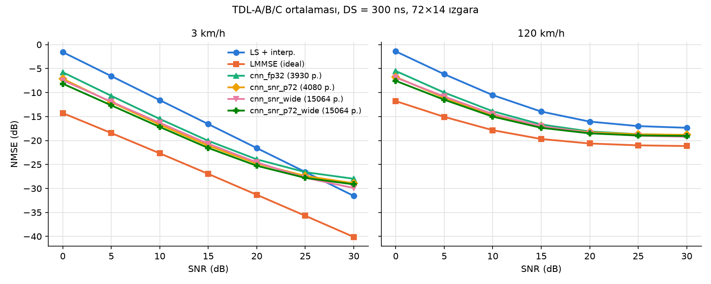

# FPGA Tabanlı CNN Kanal Kestirici

5G NR benzeri bir OFDM alıcısı için, pilot tabanlı LS kanal kestirimindeki gürültüyü gideren küçük bir
evrişimli sinir ağı (CNN) ve bu ağın FPGA'ye taşınması.

Zincir:

```
NumPy kanal simülasyonu ─▶ Keras CNN (FP32) ─▶ QKeras 8 bit QAT ─▶ hls4ml (HLS C++) ─▶ Vitis HLS (sentez, co-sim)
          Mac / Linux            Mac / Linux        Mac / Linux        Mac / Linux            yalnızca Linux
```

## Sonuçlar

| Kestirici | Parametre | NMSE, 3 km/h, 10 dB | NMSE, 120 km/h, 10 dB | Doğrulama NMSE (0–30 dB karışık) |
| --- | --- | --- | --- | --- |
| LS + doğrusal interpolasyon | – | −11,6 dB | −10,5 dB | −10,2 dB |
| CNN `cnn_snr_p72`, FP32 | 4.080 | −16,7 dB | −14,7 dB | −15,6 dB |
| CNN `cnn_snr_p72_wide`, FP32 | 15.064 | −17,2 dB | −15,0 dB | −16,3 dB |
| CNN `cnn_snr_p72`, 8 bit | 4.080 | henüz ölçülmedi | henüz ölçülmedi | −15,6 dB |
| CNN `cnn_snr_p72_wide`, 8 bit | 15.064 | henüz ölçülmedi | henüz ölçülmedi | −16,2 dB |
| LMMSE (ideal istatistik, üst sınır) | – | −22,7 dB | −17,9 dB | – |

- 8 bit kuantalamanın kaybı yaklaşık 0 dB.
- hls4ml'in ürettiği C++ kodu, QKeras modeliyle **bit-bit aynı** çıktıyı veriyor (500 ızgarada 1.008.000 değerin %100'ü).
- Bilinen zayıflık: 3 km/h'de 25 dB üstünde CNN bir hata tabanına (yaklaşık −29 dB) takılıyor ve LS'nin
  (−31,6 dB) gerisinde kalıyor. Pratik çözüm, yüksek SNR'da CNN'i atlayıp LS çıktısını kullanmak.



TDL-A/B/C ortalaması, gecikme yayılımı 300 ns. Ayrıntılı sayılar `results/*.csv` dosyalarında.

## Sistem modeli

| Ayar | Değer |
| --- | --- |
| Izgara | 72 alt taşıyıcı (6 RB) × 14 OFDM sembolü (1 slot) |
| Alt taşıyıcı aralığı, taşıyıcı frekansı | 15 kHz, 3,5 GHz |
| Anten | 1 × 1 (SISO) |
| Pilot (DMRS) | 2. ve 11. sembol, her 2 alt taşıyıcıda bir (comb-2), sabit QPSK |
| Kanal | 3GPP TR 38.901 TDL-A/B/C, Jakes Doppler (sinüs toplamı) |
| Eğitim aralığı | Gecikme yayılımı 50–300 ns, hız 0–120 km/h, SNR 0–30 dB |

**Basitleştirmeler:**
- Kanal doğrudan frekans alanında üretilir. CP'nin en büyük gecikmeden uzun olduğu ve sembol içi Doppler'in
  (ICI) ihmal edilebileceği varsayılır.
- CFO ve zamanlama hatası yoktur.
- LMMSE, kanal istatistiklerini tam bildiği için üst sınır niteliğindedir.
- CNN'e gerçek SNR verilir; gerçek alıcıda SNR'ın ayrıca kestirilmesi gerekir.

**Model:** LS kestirimi önce doğrusal interpolasyonla tam ızgaraya yayılır. CNN yalnızca bu ızgaradaki
gürültüyü temizler (artık bağlantı: `çıktı = h_LS + düzeltme`). Girdi 3 kanaldır: gerçek kısım, sanal kısım
ve sabit bir SNR düzlemi. Yapı 4 adet 3×3 konvolüsyondan oluşur (16-16-8-2 ya da 32-32-16-2 kanal).

## Kurulum

Python 3.11 gerekir. TensorFlow 2.15 ile QKeras 0.9 bu sürümde uyumlu çalışıyor.

```bash
git clone https://github.com/OsmanMertYilmaz/fpga-cnn-channel-estimator.git
cd fpga-cnn-channel-estimator
python3.11 -m venv .venv
.venv/bin/pip install -r requirements.txt
```

macOS'ta Python 3.11 yoksa: `brew install python@3.11`, sonra `/opt/homebrew/bin/python3.11 -m venv .venv`.

## Kullanım

Adımlar sırayla çalıştırılır; her adımın çıktısı bir sonrakinin girdisidir. Eğitilmiş modeller depoda
olduğu için 3. ve 4. adımlar atlanabilir. Veri seti depoda yok, 2. adımla üretilmelidir. Süreler
Apple M3 (yalnızca CPU) içindir.

### 1. Klasik referanslar (yaklaşık 30 sn)

```bash
.venv/bin/python run_reference.py
```

LS + interpolasyon ve LMMSE için NMSE-SNR eğrilerini çıkarır.
Çıktılar: `results/nmse_reference.png`, `results/nmse_reference.csv`.

### 2. Veri seti (yaklaşık 5 sn)

```bash
.venv/bin/python dataset.py
```

16.000 eğitim ve 2.000 doğrulama ızgarası üretir: `data/train.npz`, `data/val.npz` (yaklaşık 277 MB).
Her ızgarada kanal tipi, gecikme yayılımı, hız ve SNR rastgele seçilir. Izgaralar 12×14'lük parçalar
hâlinde saklanır; eğitim betiği bunları istenen boyuta yeniden birleştirir.

### 3. FP32 model eğitimi (model başına 6–10 dk)

```bash
# küçük model, tam ızgara, SNR girdili
.venv/bin/python train.py --name cnn_snr_p72 --snr-input --patch 72 --filters 16 16 8

# geniş model
.venv/bin/python train.py --name cnn_snr_p72_wide --snr-input --patch 72 --filters 32 32 16
```

| Seçenek | Anlamı |
| --- | --- |
| `--name` | Model adı → `models/<name>.keras` |
| `--patch` | Bir seferde işlenen alt taşıyıcı sayısı: 12, 24, 36 ya da 72 (tam ızgara) |
| `--filters` | Gizli katmanların kanal sayıları |
| `--snr-input` | SNR'ı 3. girdi kanalı olarak ver |
| `--no-weight` | SNR ağırlıklı kaybı kapat (varsayılan: açık; yüksek SNR örneklerinin de öğrenilmesini sağlar) |

### 4. Karşılaştırma (yaklaşık 1–2 dk)

```bash
.venv/bin/python evaluate.py --models cnn_snr_p72 cnn_snr_p72_wide --out nmse_compare
```

Verilen modelleri LS ve LMMSE ile aynı test senaryolarında (3 ve 120 km/h, 0–30 dB) karşılaştırır.
Çıktılar: `results/nmse_compare.png`, `results/nmse_compare.csv`. Yalnızca FP32 `.keras` modellerini okur.

### 5. 8 bit kuantalama, QAT (model başına 8–12 dk)

```bash
.venv/bin/python quantize.py --name cnn_snr_p72
.venv/bin/python quantize.py --name cnn_snr_p72_wide
```

FP32 ağırlıklardan başlayıp aynı mimarinin QKeras karşılığını ince ayarlar.
Çıktı: `models/q_<name>.weights.h5`.

| Büyüklük | Biçim | Aralık, adım |
| --- | --- | --- |
| Girdi (h_LS, SNR düzlemi) | `ap_fixed<12,4>` | ±8, 1/256 |
| Ağırlık, bias | `ap_fixed<8,1>` | ±1, 1/128 |
| Gizli aktivasyonlar | `ap_ufixed<8,2>`, son gizli katman `ap_ufixed<8,3>` | 0–4 / 0–8 |
| Düzeltme çıktısı | `ap_fixed<10,3>` | ±4, 1/128 |

### 6. hls4ml dönüşümü ve bit-bit doğrulama (model başına yaklaşık 1–2 dk)

```bash
.venv/bin/python hls_convert.py --name cnn_snr_p72
.venv/bin/python hls_convert.py --name cnn_snr_p72_wide
```

- Modeli `hls/<name>/` altında bir Vitis HLS projesine çevirir (`io_stream`, `Strategy=Resource`).
- Üretilen C++'ı yerel derleyiciyle derleyip QKeras çıktısıyla karşılaştırır. Beklenen çıktı:

```
cnn_snr_p72: 1008000 çıktı değeri, bit-bit eşleşme %100.000, max fark 0.00e+00
```

- C-sim ve co-sim için test vektörleri `hls/<name>/tb_data/` altına yazılır (20 ızgara).
- `--reuse N` ReuseFactor'ü ayarlar (varsayılan 32). Yalnızca sentezi etkiler: büyük değer daha az kaynak ama
  daha uzun gecikme demektir.

### 7. Vitis HLS ile sentez (yalnızca Linux)

Vitis HLS yalnızca Linux/Windows x86_64'te çalışır. Linux makinede 1. ve 2. adımlardaki kurulum ve veri seti
hazırlandıktan sonra:

```bash
source /tools/Xilinx/Vitis_HLS/<sürüm>/settings64.sh   # kurulum yoluna göre
.venv/bin/python hls_convert.py --name cnn_snr_p72 --build --reuse 32
.venv/bin/python hls_convert.py --name cnn_snr_p72_wide --build --reuse 32
```

`--build`, C-simülasyonu, sentez ve C/RTL co-simulation'ı sırayla çalıştırır.
Raporlar `hls/<name>/chest_prj/solution1/syn/report/` altındadır (kaynak kullanımı, gecikme, II).

Hedef kart ZCU104 (`xczu7ev-ffvc1156-2-e`), saat 200 MHz. Başka bir kart için `hls_convert.py` içindeki
`PART` ve `CLOCK_NS` değiştirilir.

## Depo yapısı

```
├── ofdm_channel.py     OFDM ızgarası, TDL-A/B/C kanalı, DMRS deseni, alınan pilotlar
├── estimators.py       LS + interpolasyon, 2B LMMSE, NMSE
├── run_reference.py    1. adım: klasik referans eğrileri
├── dataset.py          2. adım: veri seti, yama dönüşümleri, SNR girdi düzlemi
├── train.py            3. adım: FP32 CNN mimarisi ve eğitimi
├── evaluate.py         4. adım: CNN / LS / LMMSE karşılaştırması
├── quantize.py         5. adım: QKeras 8 bit QAT, sayı biçimleri
├── hls_convert.py      6.–7. adım: hls4ml dönüşümü, bit-bit doğrulama, Vitis HLS derlemesi
├── models/             eğitilmiş FP32 (.keras) ve 8 bit (q_*.weights.h5) modeller
├── hls/                hls4ml'in ürettiği HLS C++ projeleri (firmware/, tb_data/, build_prj.tcl)
└── results/            NMSE grafikleri ve CSV'ler, eğitim geçmişleri
```

`models/` altındaki eski modeller (`cnn_fp32`, `cnn_fp32_mse`, `cnn_snr`, `cnn_snr_wide`) deney
karşılaştırması için tutuluyor. Donanıma gidecek adaylar `cnn_snr_p72` ve `cnn_snr_p72_wide`.

## Bilinen tuzaklar

- **QKeras + `load_model` takılması:** QKeras içe aktarıldıktan sonra `tf.keras.models.load_model`
  (Keras 2.15, `.keras` dosyası) sonsuz döngüye giriyor. Betikler FP32 modeli QKeras ve hls4ml'den önce
  yükler. Yeni betik yazarken bu sırayı koruyun.
- **TDL tablo değerleri:** `ofdm_channel.py` içindeki gecikme ve güç değerleri TR 38.901
  Tablo 7.7.2-1/2/3'ten alınmıştır; kullanmadan önce standarda karşı kontrol edilmesi önerilir.
- **NumPy sürümü:** TensorFlow 2.15, NumPy 1.26 ister; NumPy 2.x ile çalışmaz.

## Yol haritası

- [x] Klasik referanslar (LS, LMMSE)
- [x] Veri seti ve FP32 CNN
- [x] 8 bit QAT
- [x] hls4ml dönüşümü, bit-bit doğrulama
- [ ] Vitis HLS sentezi ve co-sim (kaynak, gecikme raporu)
- [ ] Kartta çalıştırma (AXI DMA + PYNQ)
- [ ] LDPC ile uçtan uca BER, eğitimde görülmeyen kanallarda genelleme testi

## Lisans

MIT, ayrıntılar için [LICENSE](LICENSE).
